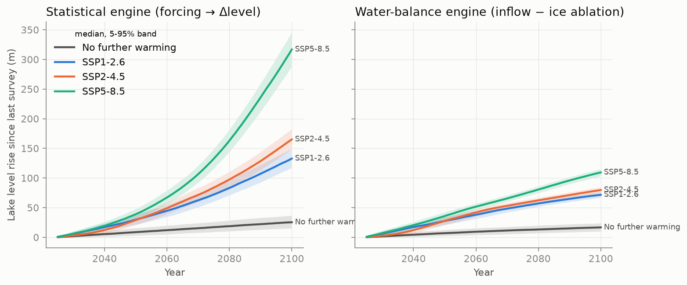
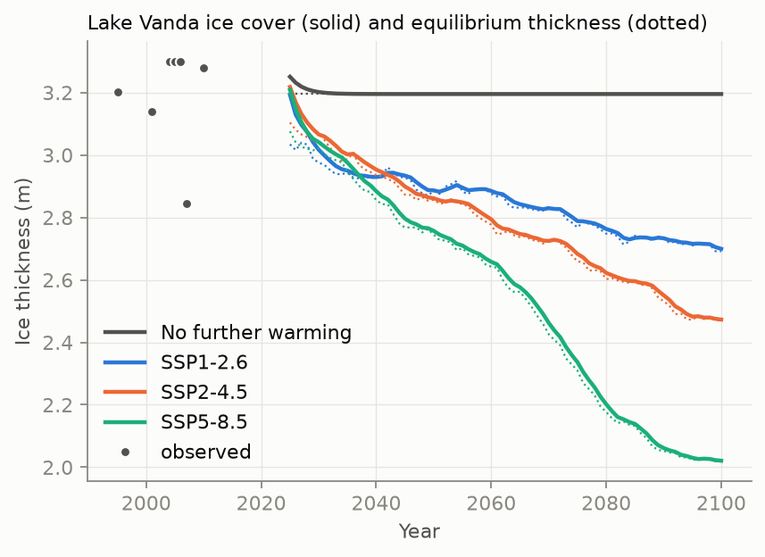
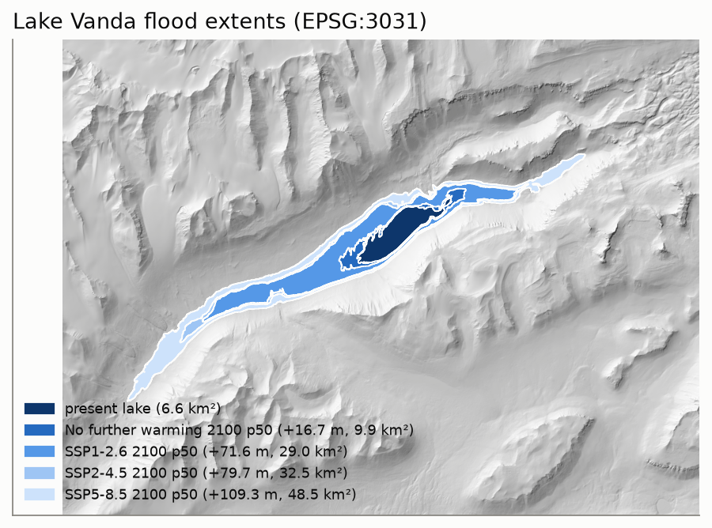
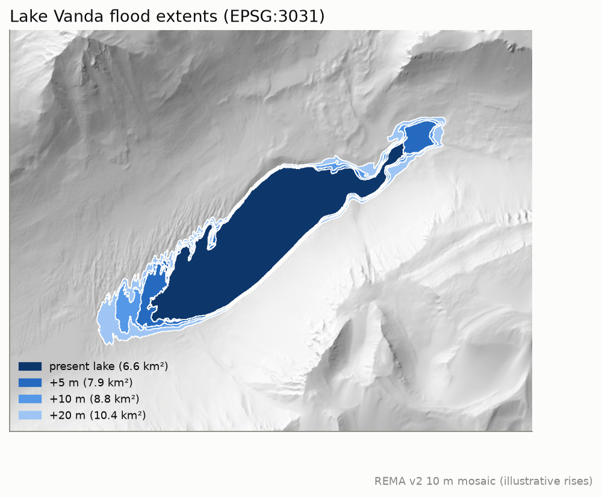
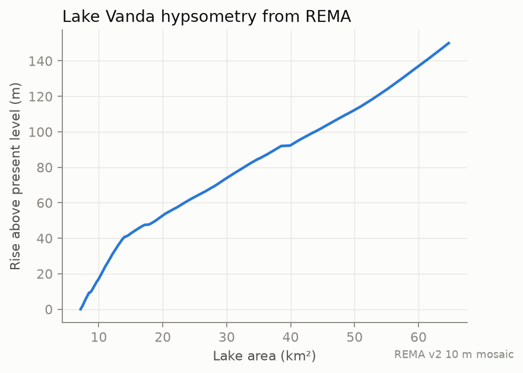
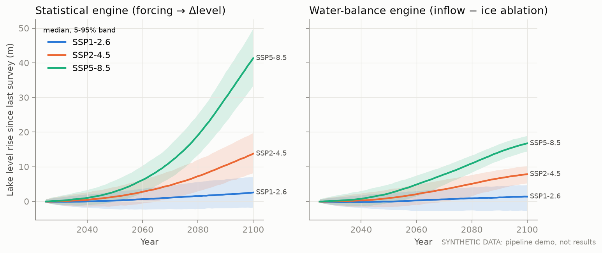

# Vanda Rising

**Probabilistic, CMIP6-forced projections of Lake Vanda's level, extent and ice cover**
(Wright Valley, McMurdo Dry Valleys, Antarctica)

Lake Vanda is a closed-basin, perennially ice-covered lake that has been filling for decades.
Its volume has grown by more than half, and the rising water flooded and closed the old
Vanda Station. Castendyk, Obryk, Leidman, Gooseff & Hawes (2016) concluded that if current
conditions continue, Vanda will keep rising for about two centuries before reaching a new
equilibrium.

This project asks what that trajectory looks like **under explicit emissions scenarios, with
uncertainty attached**, and how the lake's ice cover responds along the way. It couples three
pieces:

1. **Closed-basin water balance (hybrid physics + ML).** Onyx River inflow is learned from
   summer degree-days with a Gaussian process. Water loss through ice-cover ablation is
   calibrated from the LTER record. Lake area at each level comes from the REMA DEM. Because
   area, and therefore loss, grows as the lake rises, every scenario relaxes toward its own
   equilibrium level. The model reports that level and the e-folding time to reach it.
2. **Perennial lake-ice model.** Surface ablation is balanced by basal freezing
   (McKay et al. 1985; Obryk et al. 2016), driven by RACMO2.3p2 warming and sublimation change.
   The ice's ablation rate and the water balance's loss term describe the same physical flux,
   so their ratio is a built-in **closure test**.
3. **Statistical baseline.** A direct regression from forcing to level change, used to show
   what the physics adds.

On top of that sit **flood mapping** (REMA v2, intersected with Quantarctica's ASMA, historic
site and footprint layers) and an independent **fibre-optic check** of the climate forcing:
distributed temperature sensing (DTS) in Allan Hills boreholes, about 100 km away.

```mermaid
flowchart LR
  RACMO["RACMO2.3p2 SSP1-2.6/2-4.5/5-8.5<br/>ΔT₂ₘ, sublimation ratio"] --> F[Warmed station<br/>temperatures]
  MET[LTER Lake Vanda met] --> F
  F --> GPQ[GP: Onyx inflow] --> WB[Water balance<br/>dV = Q − l·A&#40;h&#41;]
  LV[LTER lake levels] --> CAL[Calibrate loss l] --> WB
  Q[LTER Onyx discharge] --> GPQ
  Q --> CAL
  REMA[REMA v2 DEM] --> H[Hypsometry A&#40;h&#41;] --> WB
  WB --> P[Level, area, equilibrium,<br/>e-folding time] --> INU[Flood extents ×<br/>ASMA / sites]
  RACMO --> ICE[Lake-ice model] --> CL{Closure:<br/>l ≈ a·ρᵢ/ρw}
  CAL --> CL
  DTS[Allan Hills fibre-optic DTS] -. checks .-> RACMO
```



## Status

| Piece | State |
|---|---|
| REMA fetch, lake detection, hypsometry to +150 m | **Working on real data** |
| Water balance, lake ice, statistical engines | **Run on real data**: LTER packages knb-lter-mcm.68.15, 7015.22, 9122.7 and 67.19 |
| Climate forcing | **Real**: RACMO2.3p2 driven by CESM2, historical and SSP1-2.6, 2-4.5, 5-8.5 (yearly) |
| Flood intersection with ASMA and historic sites | Waiting on the Quantarctica vector layers |
| Allan Hills DTS check | Reader written; data download sits behind a reCAPTCHA |

## Results (real data, first pass)



**1. The water balance closes.** Across seasons, Onyx River inflow and Lake Vanda's level
change correlate at r = 0.99. Calibrating against 36 seasons gives a net loss through the ice
cover of **0.215 ± 0.176 m/yr**. The independent lake-ice model implies 0.32 m/yr of water
lost through ablation, so the two estimates agree to within a factor of 1.5 (closure ratio
0.67).

**2. Lake Vanda is committed to rising even without further warming.** At today's climate,
mean inflow (3.5 × 10⁶ m³/yr) only balances ice-cover loss once the lake covers about
16 km². That happens **≈ 45 m above today's level**, with an e-folding time of
**≈ 160 years**. This independently reproduces Castendyk et al.'s (2016) conclusion that Vanda
will keep rising for about two centuries. The no-warming control rises 0.33 m in its first
year (observed: 0.34 m/yr since 1994), **+7 m (2–12 m) by 2050 and +17 m (10–24 m) by 2100**.

**3. Warming makes it much faster, but those numbers are less certain.** In the observations,
seasonal inflow grows about 2.4× per +1 °C of December–January air temperature (28 seasons).
That steep response comes from the 2001–02 flood summer and the 2008–2010 high-flow years.
Applying RACMO's warming:

| Water-balance rise (median, 5–95 %) | 2050 | 2100 |
|---|---|---|
| No further warming | +7 m (2–12) | +17 m (10–24) |
| SSP1-2.6 | +27 m (21–34) | +72 m (67–76) |
| SSP2-4.5 | +28 m (21–34) | +80 m (75–85) |
| SSP5-8.5 | +36 m (29–42) | +109 m (103–115) |

Read these with three caveats:
- **Annual vs summer warming.** The yearly RACMO files give annual-mean warming, which is
  winter-amplified in Antarctica. With `racmo.summer_scaling: 0.5` (summer warms half as
  much), 2050 rises drop to about +15 to +20 m. Seasonal (monthly) future RACMO fields
  would settle this.
- **Extrapolation.** After about 2060, most simulated summers are warmer than any observed one
  (`frac_outside_training` reaches 0.7–1.0). By then the result reflects the model's
  assumptions more than the data. A log-inflow model (`model.log_inflow: true`) blows up
  exponentially there, which shows how poorly that range is constrained.
- **Unlimited glacier supply.** Inflow is assumed to scale with degree-days indefinitely.
  Glacier retreat, changing albedo and radiation-driven melt are not modelled.

The left panel (statistical engine) learns level change directly and ignores the lake
spreading as it rises. That is fine for a few metres, but its 2100 values are not physical.
It is kept as the baseline that shows why the water balance matters.

**4. The ice cover thins.** The ice model fits the 12 Vanda thickness surveys (3.2–3.3 m,
RMSE 0.15 m) with a basal heat flux of 9.9 W/m². Its response time is short (about 2 years),
so the ice tracks climate closely. Projected thickness by 2100: 3.2 m with no warming;
2.7 m (SSP1-2.6), 2.5 m (SSP2-4.5) and 2.0 m (SSP5-8.5).




**Forecast skill, honestly.** In leave-one-season-out cross-validation, degree-days barely
beat climatology for year-to-year inflow (median absolute error 2.4 vs 2.9 × 10⁶ m³; RMSE is
dominated by flood summers). The long-run trajectory is set by the mean response, which is
better constrained than single seasons. Better predictors are the obvious next step: solar
radiation and wind are in the station file.

### Real data: Lake Vanda hypsometry from REMA v2 (10 m)




The ice surface sits at 41.4 m above the WGS84 ellipsoid. REMA heights are ellipsoidal;
only height differences are used, so no geoid correction is needed. The lake plus the
connected low ground covers about 7.2 km² today. Up to about +40 m, each metre of rise adds
about 0.15–0.2 km². Above that, the water spreads along the Wright Valley floor much faster:
19 km² at +50 m and 44 km² at +100 m.

### Pipeline demo (synthetic data, **not results**)

`vanda demo` runs everything on internally consistent synthetic data. It checks that the
machinery recovers known parameters: calibrated loss 0.325 m/yr against a true 0.33, and a
closure ratio of 1.01. Figures are in [`figures/demo_SYNTHETIC/`](figures/demo_SYNTHETIC/).



## Quickstart

```bash
python -m venv .venv && source .venv/bin/activate   # Windows: .venv\Scripts\activate
pip install -e ".[dev]"
vanda demo          # synthetic end-to-end run, no downloads
vanda fetch-dem     # REMA v2 window over Lake Vanda (public COGs, no login)
vanda hypsometry    # real level-area-volume curve and flood maps
# ...download LTER and Quantarctica files (docs/data_sources.md), edit config.yaml, then:
vanda run
vanda dts-check     # optional: Allan Hills fibre-optic DTS vs RACMO / IMAU-FDM
pytest
```

## Research questions

1. **Trajectory.** How high will Vanda be in 2050 and 2100 under SSP1-2.6, SSP2-4.5 and
   SSP5-8.5, and how wide are the uncertainty bands?
2. **Equilibrium.** What level and area balance inflow against ablation in each scenario's
   late-century climate? Is the e-folding time consistent with the two-century adjustment
   that Castendyk et al. (2016) described?
3. **Ice cover.** Does warming thin Vanda's ~3.5–4 m ice (Hawes et al. 2013), and over what
   response time? Does the ice model's ablation agree with the water balance's loss term?
4. **Footprint.** Which protected-area zones, historic sites and disturbance footprints do the
   projected shorelines reach?
5. **Forcing credibility.** Do RACMO 2 m temperature and IMAU-FDM firn temperature match the
   DTS-measured near-surface ice temperature at Allan Hills?

## Method notes and honest limitations

- **Delta change.** RACMO's 27 km grid cannot resolve the valley (and its föhn events). The
  nearest cells sit at 900–1600 m, against 96 m for the lake, so only RACMO *changes* are used.
  They are taken relative to 1994–2025, the years the station record covers, and smoothed with
  a 21-year running mean. Annual-mean warming is applied evenly to every summer hour, scaled by
  `racmo.summer_scaling`.
- **Extrapolation.** Warm-scenario summers can lie outside the observed degree-day range.
  The GP has a linear kernel term so it doesn't revert to the mean outside the data, and
  every projection reports `frac_outside_training`. Read high-end SSP5-8.5 numbers with that
  in mind.
- **Bathymetry.** The DEM sees only the ground above today's level. That is enough for a
  rising lake, but it means the model cannot handle a falling one.
- **Glacier supply is treated as unlimited.** Inflow responds to degree-days only. Changes in
  the Wright Lower Glacier itself (ITS_LIVE velocity, ICESat-2 elevation change, both in
  Quantarctica) are a natural next step.
- **Lumped ice physics.** The basal flux `F` lumps water-column heat with shortwave absorbed
  in the ice. Obryk et al. (2016) resolve these separately; this model does not.
- **DEM epoch.** Set `lter.rema_epoch` to the REMA acquisition date (see the tile `meta.txt`
  files) so flood extents start from the right shoreline.

## Fibre-optic sensing

Public Antarctic fibre-optic datasets found (Nov 2026) and how they are used:
[docs/fibre_optic_datasets.md](docs/fibre_optic_datasets.md). No DAS or DTS deployment in the
Dry Valleys turned up. The Allan Hills borehole DTS is the closest and serves as a forcing check.

## Key references

- Castendyk, D.N., Obryk, M.K., Leidman, S.Z., Gooseff, M., Hawes, I. (2016). Lake Vanda: a sentinel for climate change in the McMurdo Sound Region of Antarctica. *Global and Planetary Change* 144, 213–227. doi:10.1016/j.gloplacha.2016.06.007
- Hawes, I., Sumner, D.Y., Andersen, D.T., Jungblut, A.D., Mackey, T.J. (2013). Timescales of growth response of microbial mats to environmental change in an ice-covered Antarctic lake. *Biology* 2, 151–176. doi:10.3390/biology2010151. Source for Vanda's lake-level history, its 3.5–4 m ice and light transmission.
- Obryk, M.K., et al. (2016). Modeling the thickness of perennial ice covers on stratified lakes of the Taylor Valley, Antarctica. *Journal of Glaciology*.
- McKay, C.P., Clow, G.D., Wharton, R.A., Squyres, S.W. (1985). Thickness of ice on perennially frozen lakes. *Nature* 313, 561–562.
- Data sources and licences: [docs/data_sources.md](docs/data_sources.md).

## Licence

Code: MIT (see `LICENSE`). Data keep their own licences; cite them as listed in
`docs/data_sources.md`. This is an independent hobby project and is not affiliated with the
McMurdo LTER, Antarctica New Zealand or the cited authors.
